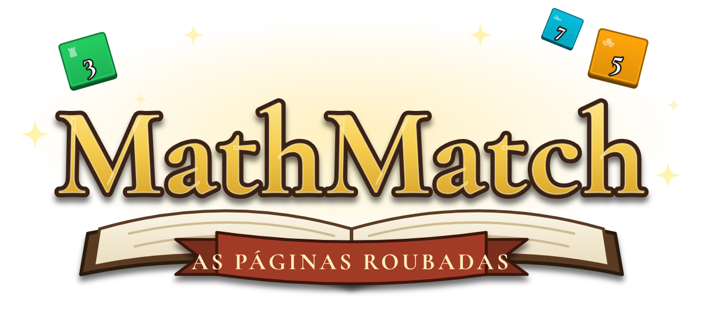
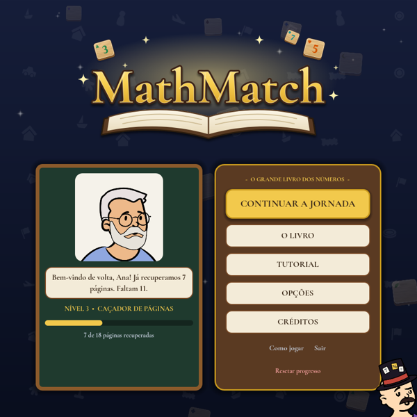
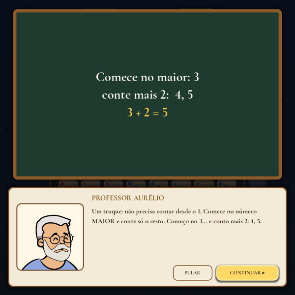
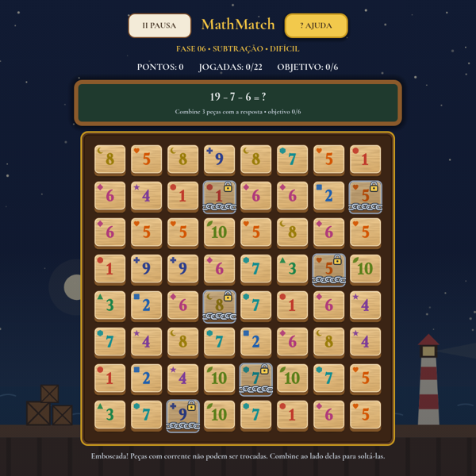
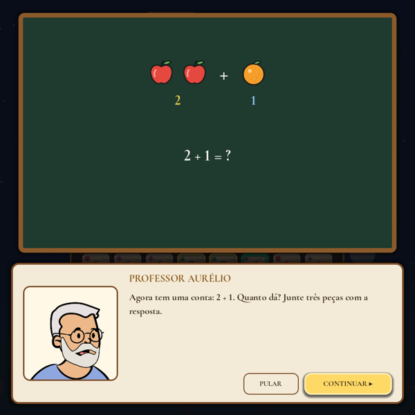
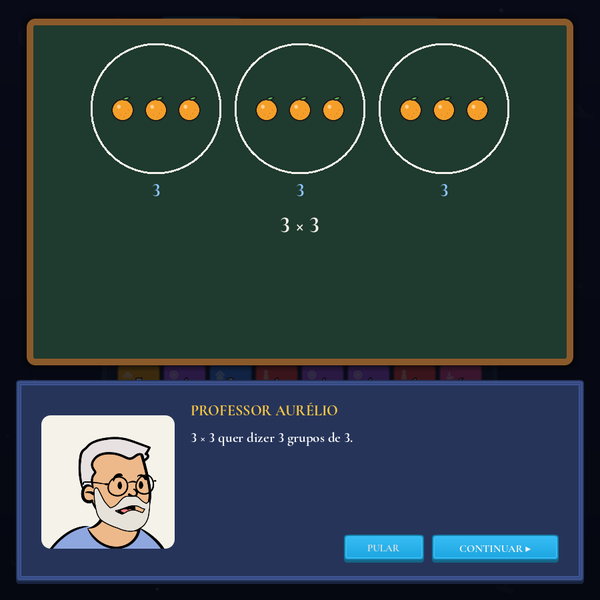
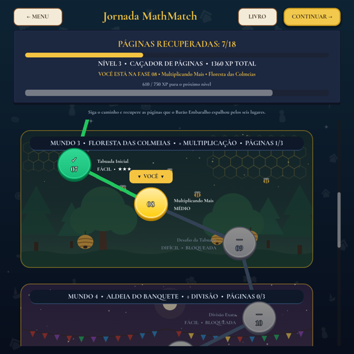
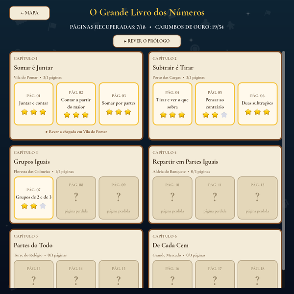
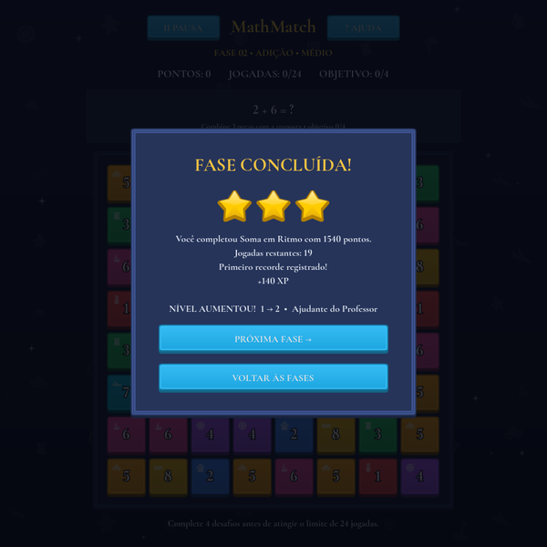
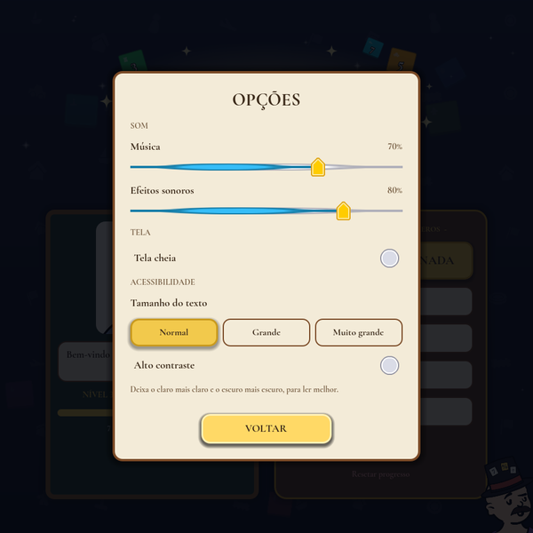

<p align="center">
  
</p>

# MathMatch: As Páginas Roubadas

Jogo educacional de matemática no estilo **match-3**, feito em **Godot 4.3** com **GDScript**.

O Barão Embaralho roubou as páginas do Grande Livro dos Números, e o jogador ajuda o velho **Professor Aurélio** a recuperá-las. Em cada fase aparece uma conta, por exemplo `3 + 2 = ?`. O jogador resolve de cabeça e forma, no tabuleiro 8×8, uma linha ou coluna de **3 ou mais peças com o número da resposta**. Quando trava, o professor vai até a lousa e ensina o caminho.

**Equipe:** Tiago Spezia, Matheus Machado, Samuel Ballock, Eduardo de Souza e Mateus Wroblewski.

<p align="center">
  
  
  
</p>

---

## O que tem no jogo

| | |
|---|---|
| **6 operações, 18 fases** | Adição, subtração, multiplicação, divisão, fração e porcentagem, cada uma com uma fase fácil, uma média e uma difícil |
| **História** | Prólogo, 6 lugares para visitar, um vilão, as 18 páginas do livro para recuperar e um final, tudo com diálogos e retratos dos personagens |
| **Professor que ensina** | Aula completa na primeira fase de cada operação, numa lousa com frutas, doces e objetos desenhados; exercícios com correção explicada; dicas que crescem com os erros; botão **? AJUDA** |
| **Emboscadas do Barão** | Nas fases difíceis: ventania, correntes, enxame, neblina, ponteiro maluco e uma emboscada final |
| **Progresso** | Estrelas (carimbos de ouro), recordes, XP, nível e títulos (de Aprendiz a Mestre dos Números) |
| **Grande Livro dos Números** | As páginas recuperadas, com a lição de cada uma e as cenas para rever |
| **Tutorial guiado** | 5 passos explicados pelo professor |
| **Acessibilidade** | Tamanho do texto (Normal, Grande, Muito grande) e alto contraste |
| **Som** | Duas músicas originais e efeitos sonoros |

A explicação completa do jogo está em [`docs/SOBRE_O_JOGO.md`](docs/SOBRE_O_JOGO.md), e o andamento do desenvolvimento em [`docs/O_QUE_JA_FOI_FEITO.md`](docs/O_QUE_JA_FOI_FEITO.md).

---

## Como rodar o projeto (passo a passo)

### 1. Instale o Godot 4

1. Acesse <https://godotengine.org/download>.
2. Baixe o **Godot 4.3** ou mais novo, na versão padrão (**não** a versão ".NET/C#"; o projeto usa só GDScript).
3. O Godot não precisa de instalação: extraia o `.zip` baixado e abra o executável (no Windows, `Godot_v4.x-stable_win64.exe`).

> O projeto foi feito para o Godot **4.3**. Versões 4.x mais novas também devem abrir; o Godot 3 **não** abre o projeto.

### 2. Baixe o código

- **Com Git:**
  ```bash
  git clone https://github.com/tiagospezia1/MathMatch.git
  ```
- **Sem Git:** no GitHub, clique em **Code → Download ZIP** e extraia o arquivo numa pasta.

### 3. Importe o projeto no Godot

1. Abra o Godot. Vai aparecer o **Gerenciador de Projetos**.
2. Clique em **Importar** (*Import*).
3. Selecione o arquivo **`project.godot`**, na pasta do projeto.
4. Clique em **Importar e Editar** (*Import & Edit*).
5. Na primeira vez, o Godot importa as imagens, os sons e a fonte. Espere a barra de progresso terminar.

### 4. Rode o jogo

- Aperte **F5** ou clique no botão **▶ (Executar Projeto)**, no canto superior direito do editor.
- O jogo abre na tela inicial, numa janela de 900×900.
- Para fechar, feche a janela do jogo ou aperte **F8** no editor.

### 5. (Opcional) Gere um executável

1. No editor, vá em **Projeto → Exportar...** (*Project → Export...*).
2. Clique em **Adicionar...** e escolha a plataforma (por exemplo **Windows Desktop**).
3. Se o Godot pedir, clique em **Gerenciar modelos de exportação** e baixe os *export templates* da sua versão.
4. Clique em **Exportar Projeto** e **desmarque "Exportar com Depuração"** (*Export With Debug*). Assim o modo desenvolvedor não aparece na versão final.

---

## Como jogar

1. Na tela inicial, clique em **COMEÇAR A AVENTURA**. Na primeira vez vem o prólogo (o professor pergunta o seu nome) e o **tutorial** guiado.
2. No mapa, escolha a fase. Na primeira fase de cada operação, o professor dá uma aula na lousa.
3. Leia a conta no topo da tela e calcule a resposta.
4. Clique numa peça e depois numa peça vizinha para trocá-las de lugar.
5. Forme uma linha ou coluna de 3 ou mais peças com o número da resposta.
6. Complete os desafios antes de acabarem as jogadas. Quanto mais jogadas sobrarem, mais carimbos de ouro.

**Ajuda:** errou duas vezes? O professor vai à lousa e explica a conta. O botão **? AJUDA** também chama o professor a qualquer momento.

**Atalhos:** **ESC** ou o botão **II PAUSA** abre o menu de pausa. Nos diálogos, clique, ENTER ou ESPAÇO avançam e ESC pula a cena.

**Salvamento:** é automático, na pasta de dados do Godot (`user://mathmatch_progress.json` e `user://mathmatch_settings.cfg`). No Windows ela fica em `%APPDATA%\Godot\app_userdata\MathMatch\`. Para recomeçar do zero, use **Resetar progresso** na tela inicial.

---

## Telas

| Tutorial com o professor | Dica na partida | Mapa de fases |
|---|---|---|
|  |  |  |
| **Grande Livro dos Números** | **Vitória** | **Opções e acessibilidade** |
|  |  |  |

---

## Estrutura do projeto

```text
MathMatch/
├── project.godot                # configuração (cena inicial, autoloads, janela, ícone)
├── scenes/
│   ├── MainMenu.tscn            # tela inicial
│   ├── ProgressionMenu.tscn     # mapa de fases
│   ├── Game.tscn                # partida (tabuleiro), tutorial, aulas e emboscadas
│   ├── BookMenu.tscn            # o Grande Livro dos Números
│   ├── CreditsMenu.tscn         # créditos
│   └── DeveloperMenu.tscn       # modo desenvolvedor (só em builds de depuração)
├── scripts/
│   ├── main_menu.gd             # tela inicial
│   ├── progression_menu.gd      # mapa, fases e páginas por mundo
│   ├── game.gd                  # tabuleiro, desafios, dicas, pausa, tutorial e emboscadas
│   ├── book_menu.gd             # tela do livro
│   ├── credits_menu.gd          # créditos
│   ├── story.gd                 # textos da história (cenas, páginas, falas)
│   ├── professor.gd             # aulas, explicações das contas e erros comuns
│   ├── lousa.gd                 # a lousa desenhada do professor
│   ├── dialogue_box.gd          # caixa de diálogo (retratos, lousa, exercícios)
│   ├── math_tutor.gd            # dica curta embaixo da conta
│   ├── options_panel.gd         # opções (som, tela, acessibilidade)
│   ├── ui_style.gd              # visual dos menus (couro, papel e dourado)
│   ├── developer_menu.gd        # ferramentas de teste
│   ├── game_state.gd            # autoload GameState: fases, XP, títulos e salvamento
│   ├── assets.gd                # autoload Assets: imagens, fonte e efeitos visuais
│   └── audio_manager.gd         # autoload Audio: música, efeitos e opções
├── assets/                      # imagens, sons, música, fonte e licenças (ver assets/LEIA-ME.md)
├── docs/
│   ├── SOBRE_O_JOGO.md          # o jogo completo
│   ├── O_QUE_JA_FOI_FEITO.md    # andamento do desenvolvimento
│   ├── HISTORIA.md              # roteiro da história e guia de implementação
│   ├── imagens/                 # prints usados neste README
│   └── registros/               # registros das entregas anteriores
└── tools/                       # scripts que geram o logo, as músicas e os fundos do mapa (o Godot ignora)
```

### Assets

O jogo procura cada arquivo de `assets/` pelo nome; se um arquivo não existir, ele usa um visual simples no lugar e continua funcionando. Os nomes esperados estão em [`assets/LEIA-ME.md`](assets/LEIA-ME.md).

---

## Modo desenvolvedor

Serve para testar fases e progresso durante o desenvolvimento: abre qualquer operação, mostra a resposta esperada e tem um botão para concluir a fase na hora. Ele só aparece em builds de depuração (rodando pelo editor). No executável exportado sem depuração, ele fica escondido.

---

## Problemas comuns

| Problema | Solução |
|---|---|
| O Godot não abre o projeto | Confira se está usando o **Godot 4.3+** e não o Godot 3. |
| Imagens ou sons não aparecem | Espere a importação terminar. Se continuar, feche o Godot, apague a pasta oculta `.godot/` do projeto e abra de novo. |
| Tela cinza ao rodar | Em **Projeto → Configurações do Projeto → Aplicação → Executar**, a cena principal deve ser `res://scenes/MainMenu.tscn`. |
| Um asset novo não é carregado | O nome do arquivo deve estar em letras minúsculas, sem acento e sem espaço, igual ao `assets/LEIA-ME.md`. |
| O texto ficou grande demais | Em **OPÇÕES → Tamanho do texto**, volte para **Normal**. |

---

## Créditos

- Peças, botões, painéis, fundos, brilhos e efeitos sonoros: **Kenney** (kenney.nl), licença CC0.
- Retratos dos personagens: feitos com **Open Peeps**, de Pablo Stanley, licença CC0.
- Fonte: **Cormorant Garamond**, de Christian Thalmann, SIL Open Font License 1.1.
- Músicas, logo, ícone, fundos do mapa e desenhos da lousa: feitos para o MathMatch.

Detalhes em [`assets/CREDITOS.md`](assets/CREDITOS.md) e licenças em `assets/licencas/`.
